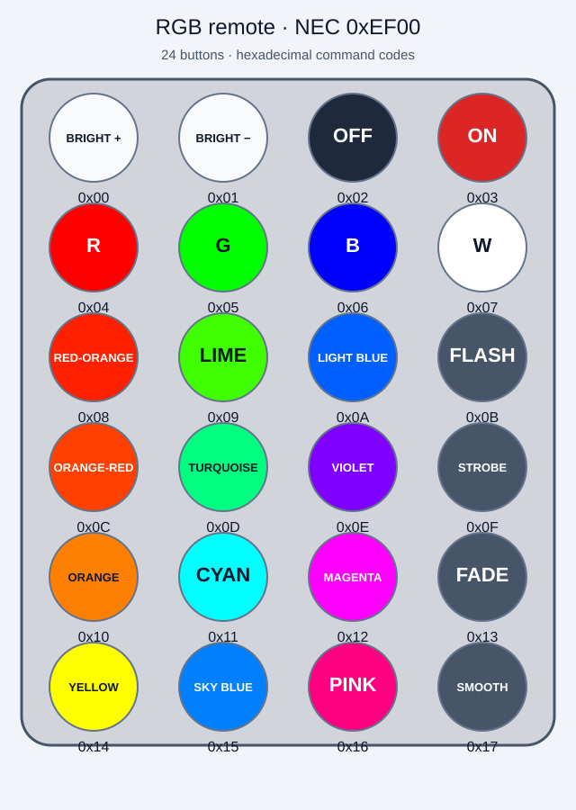

# Arduino RGB Lab

Arduino Uno sketches with a shared Makefile for uploading and serial monitoring.

| Sketch | Description |
|---|---|
| [IRReceiver](IRReceiver/IRReceiver.ino) | Control an RGB LED with a 24-button IR remote: 16 colors, brightness, power, and four effects |
| [IRReceiverAlternative](IRReceiverAlternative/IRReceiverAlternative.ino) | Same controls with gamma 2.8 and green output limited to 64/255 PWM |

## IRReceiver hardware

- Arduino Uno R3 or compatible ATmega328P board
- 38 kHz IR receiver
- Common-cathode RGB LED module with current-limiting resistors
- 24-button NEC RGB remote, USB data cable, and jumper wires

### Wiring

Disconnect USB power before changing connections. Identify the receiver's pins
from its datasheet; their physical order depends on the part.

| Component | Pin | Uno |
|---|---|---|
| IR receiver | OUT | D2 |
| IR receiver | GND | GND |
| IR receiver | VCC | 5V, for a 5V-compatible receiver |
| RGB module | R | D9 |
| RGB module | G | D10 |
| RGB module | B | D6 |
| RGB module | − | GND |

## Setup

Requires Arduino CLI at `~/.local/bin/arduino-cli` and GNU Make.
Install the board package and library:

```bash
~/.local/bin/arduino-cli core update-index
~/.local/bin/arduino-cli core install arduino:avr
~/.local/bin/arduino-cli lib install IRremote
```

From the project directory, list available sketches:

```bash
make
```

Select a sketch explicitly to compile, upload, and open its serial monitor:

```bash
make run SKETCH=IRReceiver
```

This uploads through `/dev/ttyUSB0` and opens the serial
monitor at 115200 baud. Press **Ctrl+C** to close the monitor before uploading
again. Change the port in [Makefile](Makefile) if needed.

### Adding a sketch

Create `<Name>/<Name>.ino` in the project root, then run
`make run SKETCH=<Name>`. Sketches appear automatically in the `make` listing.
The shared Makefile targets the Uno and uses 115200 baud for serial monitoring.

### WSL 2

The Uno must be attached to WSL using `usbipd-win`. After reconnecting USB, run
this in Windows PowerShell, replacing `<BUSID>` with the Uno's ID from
`usbipd list`:

```powershell
usbipd attach --wsl --busid <BUSID>
```

The device must first be shared once with
`usbipd bind --busid <BUSID>` in Administrator PowerShell.

## IRReceiver remote



Protocol: **NEC**. Address: **`0xEF00`**. Commands below are hexadecimal,
arranged in the same rows and columns as the remote.

| Left | Center-left | Center-right | Right |
|---|---|---|---|
| `00` Brighter | `01` Dimmer | `02` OFF | `03` ON |
| `04` Red | `05` Green | `06` Blue | `07` White |
| `08` Red-orange | `09` Green-spring | `0A` Blue-violet | `0B` FLASH |
| `0C` Orange | `0D` Spring green | `0E` Violet | `0F` STROBE |
| `10` Amber | `11` Turquoise | `12` Purple | `13` FADE |
| `14` Yellow | `15` Cyan | `16` Magenta | `17` SMOOTH |

### Palette

Each color column advances in **15° hue steps**, from a primary color to its
adjacent secondary color. White has a separate button.

- Red column: red (0°) → yellow (60°).
- Green column: green (120°) → cyan (180°).
- Blue column: blue (240°) → magenta (300°).

All hues use HSL saturation 100% and lightness 50%, following the
[W3C HSL definition](https://www.w3.org/TR/css-color/#the-hsl-notation).
Equal hue spacing does not imply equal perceived brightness.
The original sketch applies overall brightness directly to the palette values.

| Command | Color | Hue | RGB |
|---|---|---|---|
| `04` | Red | 0° | `255, 0, 0` |
| `08` | Red-orange | 15° | `255, 64, 0` |
| `0C` | Orange | 30° | `255, 128, 0` |
| `10` | Amber | 45° | `255, 191, 0` |
| `14` | Yellow | 60° | `255, 255, 0` |
| `05` | Green | 120° | `0, 255, 0` |
| `09` | Green-spring | 135° | `0, 255, 64` |
| `0D` | Spring green | 150° | `0, 255, 128` |
| `11` | Turquoise | 165° | `0, 255, 191` |
| `15` | Cyan | 180° | `0, 255, 255` |
| `06` | Blue | 240° | `0, 0, 255` |
| `0A` | Blue-violet | 255° | `64, 0, 255` |
| `0E` | Violet | 270° | `127, 0, 255` |
| `12` | Purple | 285° | `191, 0, 255` |
| `16` | Magenta | 300° | `255, 0, 255` |
| `07` | White | — | `255, 255, 255` |

### Controls

- Brightness has 15 nonzero levels. Hold a brightness button to repeat.
- OFF disables output and ignores all buttons except ON.
- ON restores the selected color, brightness, and mode.
- Selecting a color stops the effect.
- Startup defaults to red at full brightness. Settings reset on power loss.

### Effects

| Button | Behavior |
|---|---|
| FLASH | Cycle through seven colors, changing every 500 ms |
| STROBE | Alternate white and off, 100 ms each |
| FADE | Blend through seven colors, 2 seconds per transition |
| SMOOTH | Blend through red, green, and blue, 2 seconds per transition |

The seven-color sequence is red, yellow, green, cyan, blue, magenta, and white.
Effects run without blocking remote input.

## Alternative sketch

`IRReceiverAlternative` is a separate copy with the same wiring, buttons, palette,
and effects. Its output applies gamma correction (exponent 2.8), followed by
channel balance and brightness scaling. Green PWM is limited to 64/255.

```bash
make run SKETCH=IRReceiverAlternative
```

[Alternative remote diagram](remote-alternative.svg). Diagram swatches and palette
values describe logical colors before output correction.

Gamma follows [Adafruit's LED correction approach](https://learn.adafruit.com/led-tricks-gamma-correction/the-longer-fix).
Gamma 2.8 is an experimental starting value. The green limit is a visual balance
estimate for this LED. Adjustments to this version are independent of `IRReceiver`.

## Code

[IRReceiver/IRReceiver.ino](IRReceiver/IRReceiver.ino) contains the pin assignments,
command map, RGB presets, and effect timings as named constants and tables.
[IRReceiverAlternative/IRReceiverAlternative.ino](IRReceiverAlternative/IRReceiverAlternative.ino)
contains the independent experimental version.
